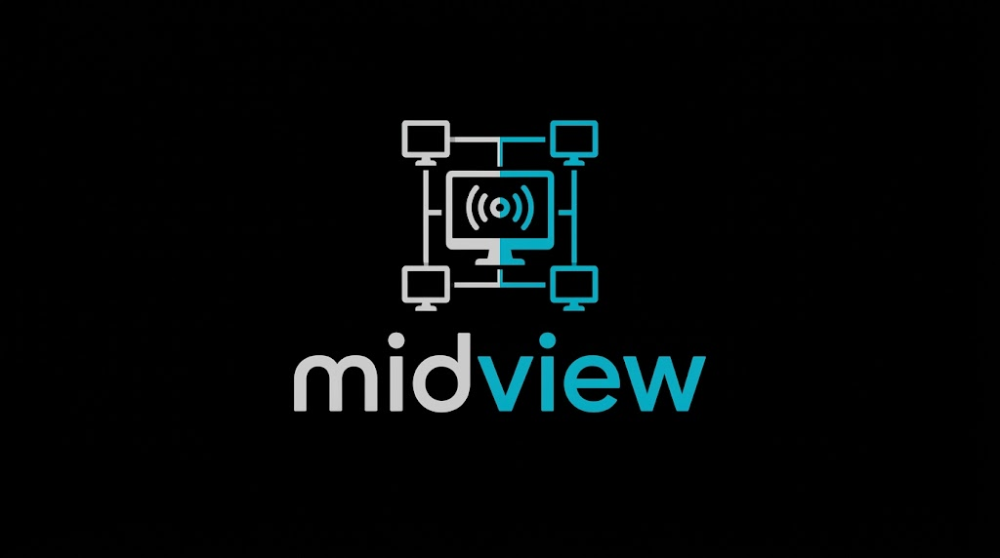
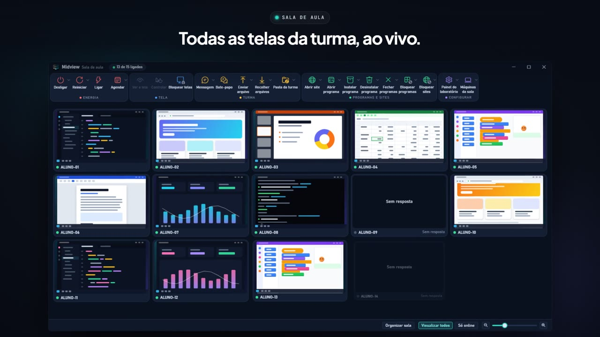
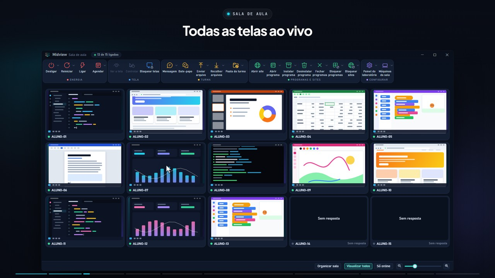

<p align="center">
  
</p>

# Midview

[Português](README.md) · **English**

[](https://github.com/ArnoNeto1/midview/releases/latest)
[](https://github.com/ArnoNeto1/midview/releases)
[-0e7490?style=for-the-badge)](https://github.com/ArnoNeto1/midview/releases/latest/download/MidviewSetup.exe)

> The button above always downloads the newest version. The same installer
> works for the teacher's computer and for the students' machines.
> Website for teachers: https://arnoneto1.github.io/midview/en/

Midview manages a school's computer lab. From their own computer, the teacher sees and controls the students' machines, talks to the class, sends and collects files, blocks programs and websites, and turns the lab on or off. Everything runs over the school's local network, with no outside server. Only the teacher's computer uses the internet, to fetch Midview updates from GitHub.

> **Language:** Midview's interface, installer and videos are in Brazilian Portuguese. In this page, each English name is followed by the label you will see in the app, in Portuguese.

## See it in action

[](https://arnoneto1.github.io/midview/midview.mp4)

[Watch the narrated video](https://arnoneto1.github.io/midview/midview.mp4) (MP4, 1 min 36 s, narrated in Portuguese): every toolbar feature, in the dark look of version 0.0.41. Power (shut down, restart, turn on and schedule), Screen (view, control and lock screens), Class (message, chat, send and collect files, class folder), Programs and websites (open a website or program, install, uninstall, close and block programs, block websites) and Settings (lab panel and classroom machines). The machines and screens in it are made up.

### Full tutorial

A step-by-step, narrated walkthrough of every feature, in the dark look of version 0.0.41: installation, pairing, the classroom, power, screen, class, programs and websites, settings, the right-click menu and a classroom with two teachers.

[](https://arnoneto1.github.io/midview/tutorial.mp4)

[Watch the tutorial](https://arnoneto1.github.io/midview/tutorial.mp4) (MP4, 8 min, narrated in Portuguese).

## What the teacher can do

The "Midview - Sala de aula" (classroom) window shows every machine's screen in a grid. The toolbar buttons act on the whole class; right-clicking a machine acts only on the selected ones.

| Group | Features |
| --- | --- |
| **Power** (Energia) | **Shut down** (Desligar) and **Restart** (Reiniciar), with a 1- or 5-minute warning and, if you want, installing the pending Windows updates; **Turn on** (Ligar) over the network (Wake-on-LAN); **Schedule** (Agendar) the days and times to turn on and shut down. |
| **Screen** (Tela) | **View the screen** (Ver a tela) of a student; **Control** (Controlar) the machine (the student's keyboard and mouse are locked and they see the notice "Este computador está sendo controlado pelo professor", "This computer is being controlled by the teacher"). Control keeps working when the UAC screen (the administrator password prompt) appears: with the lab's password saved, **Fill in the administrator password** (Preencher a senha de administrador) types it into the UAC prompt in one click. **Lock screens** (Bloquear telas) with a padlock; while the screens are locked, Ctrl+Alt+Del doesn't open Task Manager, Sign out, Switch user, Lock, Change a password or the shut down, restart and sleep button, and the Ctrl+Alt+Del screen closes by itself. |
| **Class** (Turma) | **Message** (Mensagem) on everyone's screen; **Chat** (Bate-papo) with the class (replies reach only the teacher); **Send file** (Enviar arquivo) to the "Arquivos do professor" (teacher's files) folder; **Collect files** (Recolher arquivos) from the "Entregar ao professor" (hand in to the teacher) folder; **Class folder** (Pasta da turma), a folder on the students' desktop where whatever each one downloads or saves shows up on every computer (with classes, lessons and up to two teacher PCs). During the lesson, downloads from any program go to the class folder, and Word, Excel, PowerPoint (2016 or newer), Notepad and Paint open "Save as" in it. |
| **Programs and websites** (Programas e sites) | **Open website** (Abrir site) and **Open program** (Abrir programa) on the machines; **Install program** (Instalar programa) on the whole class, as administrator, with no UAC screen and no password to type; **Uninstall program** (Desinstalar programa); **Close programs** (Fechar programas), with a warning and time for the student to save; **Block programs** (Bloquear programas) (a blocklist, or only the allowed ones); **Block websites** (Bloquear sites) (the whole internet or only some websites, still in effect after a restart). |
| **Settings** (Configurar) | **Lab panel** (Painel do laboratório) (Chrome and Windows policies, such as an ad blocker, blocking downloads, guest mode and locking the student's desktop); **Classroom machines** (Máquinas da sala), with the pages Find and pair (Procurar e parear: search the network and pair by checking a code within 5 minutes), Updates (Atualizações: update this computer and the machines), Another teacher (Outro professor: give a colleague access or join theirs), Administrator password (Senha de administrador: save the lab's password) and Advanced (Avançado). |

The right-click menu also has **Talk** (Conversar) to a single student, **Uninstall program** (Desinstalar programa), **Edit the machine** (Editar a máquina) and **Remove from the classroom list** (Remover da lista da sala). In the bottom bar, **Show all** (Visualizar todos) fits every screen, **Online only** (Só online) hides the machines that are off, and the slider changes the size of the screens (Ctrl + mouse wheel works too). **Arrange room** (Organizar sala) lets you drag the screens until they match how the machines sit in the room, and **Align** (Alinhar) straightens the grid.

## How it works

The same installer has two types:

- **Teacher** (Professor): installs the "Midview - Sala de aula" program, which runs without administrator rights.
- **Student** (Aluno): installs the **Midview Agent** service, which runs as system on each lab machine, and the program that shows messages, the screen lock and notices to the student.

The teacher finds the machines on the network and pairs each one by checking, within 5 minutes, a 6-digit code shown on the student's screen. After that, the machine only accepts paired teachers. Commands, screens and files travel encrypted with TLS and Midview's own certificates; only machine discovery and Wake-on-LAN use unencrypted UDP packets. Midview has no telemetry. The only internet connection is from the teacher's computer to GitHub, to check for a new version and download it; the students' machines receive updates over the local network.

Ports used on the local network:

| Port | Use |
| --- | --- |
| TCP 28900 | Commands to the student service |
| TCP 5901 | Screen and remote control |
| TCP 5902 | Screen and remote control on the secure desktop (UAC) |
| UDP 28901 | Finding machines on the network |
| TCP and UDP 28902 | Another teacher's access (invitation) |
| TCP 28903 | Class folder between two teacher PCs |
| UDP 9 | Turning machines on over the network |

## Requirements

- 64-bit Windows 10 or 11, on the teacher's computer and on the machines.
- Administrator rights to install.
- Teacher and machines on the same local network. For **Turn on**, Wake-on-LAN must be enabled in the machines' BIOS and network card.
- Internet only on the teacher's computer, and only to receive Midview updates.
- No need to install .NET: it ships inside Midview.

## Installation

1. Click **⬇ Download Installer (.exe)** at the top. You don't need to install .NET or anything else.
2. On the teacher's computer, open the installer and choose **Professor** (teacher). If the "Windows protected your PC" (O Windows protegeu o computador) screen appears, click **More info** (Mais informações) and then **Run anyway** (Executar assim mesmo). It creates the "Midview - Sala de aula" shortcut on the desktop.
3. On each lab machine, open the installer and choose **Aluno** (student).
4. In Midview, click **Máquinas da sala** > **Procurar e parear** > **Procurar na rede** (search the network), select the machines and click **Parear as selecionadas** (pair the selected ones). Check the 6-digit code shown on each student's screen (you have 5 minutes to do it).

Pair the machines right after installing: until the first pairing, any teacher on the network can pair them.

The installer shows the license and asks you to accept it. To install many machines at once, use the silent installation, which skips the installer's screens:

```powershell
MidviewSetup.exe /VERYSILENT /SUPPRESSMSGBOXES /TIPO=aluno
```

Use `/TIPO=professor` on the teacher's computer. Without `/TIPO`, the silent installation installs nothing. Exit code 10 means the files were copied but the service could not be configured.

## Updating

- **Teacher's computer**: when a new version comes out on GitHub, Midview tells you as it opens. **Atualizar agora** (update now) downloads the installer, checks that it arrived intact, closes Midview, installs and opens it again on its own; **Agora não** (not now) leaves it for the next time Midview opens. You can do the same at any time in **Máquinas da sala** > **Atualizações** > **Atualizar professor** (update teacher). Windows asks for administrator permission once, and while Midview closes to install (1 or 2 minutes), the students' locked screens are released. You can also run the new version's installer over the old one.
- **Lab machines**: after the teacher's computer is updated, Midview asks whether to update the students. Or use **Máquinas da sala** > **Atualizações** > **Atualizar as máquinas pela rede...** (update the machines over the network). One machine is updated first and the others only after it confirms; if something fails, the machine goes back to the previous version on its own. Each machine leaves the grid for 1 to 3 minutes.

## More than one teacher

In **Máquinas da sala** > **Outro professor**:

- **Dar acesso a um colega...** (give a colleague access) shows a 9-character code, valid for 10 minutes. The colleague types the code in **Entrar na sala de um colega...** (join a colleague's classroom) and sees the same machines.
- **Permitir novo professor (10 minutos)** (allow a new teacher) lets the machines accept another teacher's pairing for 10 minutes.

## Uninstalling

In **Settings** > **Apps**, uninstall "Midview Professor" or "Midview Aluno". On a student machine, the uninstaller releases whatever was blocked, unlocks the desktop, gives back the download and save folders if a lesson is in progress, and asks whether to delete the paired teachers too.

The other **Lab panel** policies stay applied after uninstalling. To remove them, use **RESET geral** (general reset) in the panel before uninstalling.

## Privacy

Midview sends nothing to the developer. Between the teacher and the machines go the screen images, the text copied during remote control, the messages, the chat, the files sent and collected, the machines' names and MAC addresses, and the names of the programs opened or installed.

For updates, the teacher's computer queries GitHub (`api.github.com`), stating the installed Midview version, and downloads the installer from there. No classroom data goes with it. The students' machines don't access the internet through Midview.

A student's screen can be viewed with no notice on their machine; only remote control shows a notice. So the school must tell students and their parents or guardians that Midview is in use, as clause 6 of the [license](LICENSE) requires.

The lab's administrator password, if saved in **Máquinas da sala**, stays only on the teacher's computer, protected by Windows (user DPAPI), and is never sent to the students' machines. **Preencher a senha de administrador** types it into the controlled machine's UAC prompt only when the teacher clicks.

Some **Lab panel** options configure Google Chrome, which can then reach Google services on its own, for example to download the ad blocker.

## For developers

| Folder | Contents |
| --- | --- |
| `src/Midview.Master` | Teacher program (WPF) |
| `src/Midview.Agent` | Windows service on the students' machines |
| `src/Midview.Session` | Program that runs in the student's session: screen, control, messages and lock |
| `src/Midview.Desk` | Helper that shows and controls the secure desktop (UAC) and fills in the administrator password |
| `src/Midview.Protocol` | Shared library: messages, TLS, pairing, discovery and updates |
| `tests/` | xUnit tests and the end-to-end test (`Midview.E2E`) |
| `installer/` | Installer (Inno Setup), machine scripts and their tests |
| `docs/superpowers/` | Specifications and plans for each feature (in Portuguese) |
| `site/` | Website for teachers, in Portuguese and in English (`site/en/`), published to GitHub Pages by the **Site** workflow |
| `promo/` | Promo videos and the tutorial, made with Remotion (the GIF and MP4 files in `docs/` come from it) |

Requirements: Windows, the .NET 8 SDK and, for the installer, Inno Setup 6.

```powershell
dotnet build Midview.sln --configuration Release
dotnet test Midview.sln --configuration Release --no-build
```

Some service tests need administrator rights and are skipped without them.

To build the installer into `dist\MidviewSetup.exe` and check it:

```powershell
powershell -ExecutionPolicy Bypass -File installer\Gerar-Instalador.ps1
powershell -ExecutionPolicy Bypass -File installer\tests\Testar-Scripts.ps1 -Pacote dist
```

The version lives in `Directory.Build.props`. On GitHub, four workflows check every change: **Testes (Windows)**, **Instalador**, **Atualização pela rede (Windows de verdade)** and **Bloqueio de programas (Windows de verdade)**. A `vX.Y.Z` tag makes the **Instalador** workflow publish `MidviewSetup.exe` to the GitHub release, which is where the teacher's Midview updates from.

## License

Copyright © 2026 MidView. All rights reserved.

Midview is proprietary software, free to use for schools, under the terms of the [License](LICENSE) (in Portuguese). The third-party components included and their licenses are in [THIRD-PARTY-NOTICES.txt](THIRD-PARTY-NOTICES.txt).
