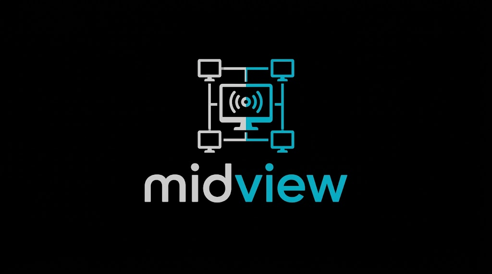
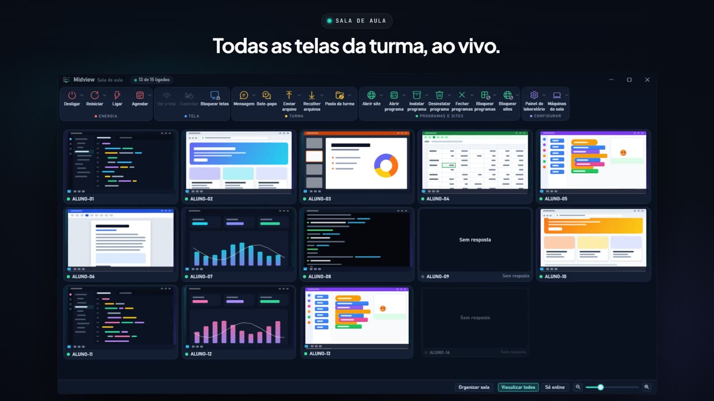
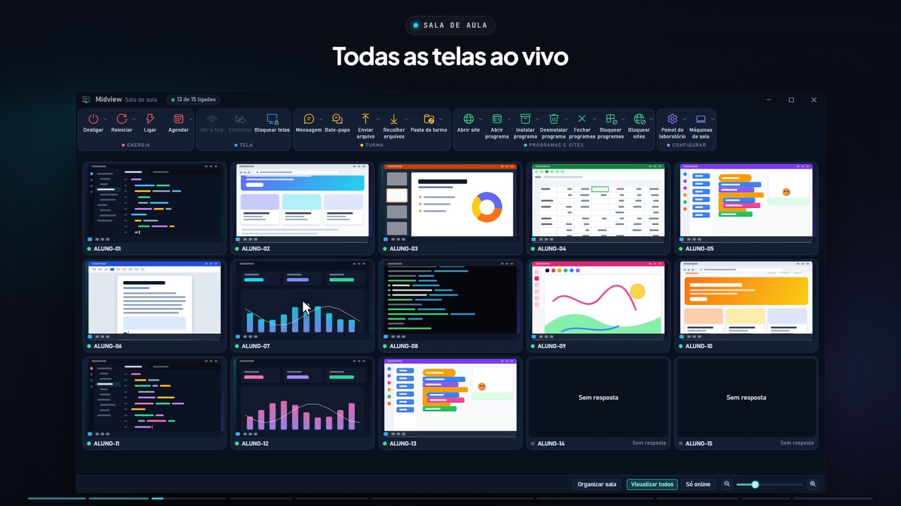

<p align="center">
  
</p>

# Midview

**Português** · [English](README.en.md)

[](https://github.com/ArnoNeto1/midview/releases/latest)
[](https://github.com/ArnoNeto1/midview/releases)
[-0e7490?style=for-the-badge)](https://github.com/ArnoNeto1/midview/releases/latest/download/MidviewSetup.exe)

> O botão acima baixa sempre a versão mais nova. O mesmo instalador serve
> para o computador do professor e para as máquinas dos alunos.
> Página para os professores: https://arnoneto1.github.io/midview/

O Midview gerencia o laboratório de informática da escola, e também os celulares e tablets Android da escola. Do próprio computador, o professor vê e controla as máquinas dos alunos, fala com a turma, envia e recolhe arquivos, bloqueia programas e sites e liga ou desliga o laboratório. Tudo passa pela rede local da escola, sem servidor externo. A internet só é usada pelo computador do professor, para buscar as atualizações do Midview no GitHub, e pelos celulares otimizados, que usam um DNS público sem anúncios (veja Privacidade).

## Veja funcionando

[](https://arnoneto1.github.io/midview/midview.mp4)

[Assista ao vídeo com narração](https://arnoneto1.github.io/midview/midview.mp4) (MP4, 1min36): todas as funções da barra, no visual escuro da versão 0.0.41. Energia (desligar, reiniciar, ligar e agendar), Tela (ver, controlar e bloquear telas), Turma (mensagem, bate-papo, enviar e recolher arquivos, pasta da turma), Programas e sites (abrir site e programa, instalar, desinstalar, fechar e bloquear programas, bloquear sites) e Configurar (painel do laboratório e máquinas da sala). As máquinas e telas que aparecem nele são fictícias.

### Tutorial completo

Passo a passo, com narração, de todas as funções, no visual escuro da versão 0.0.41: instalação, pareamento, a sala de aula, energia, tela, turma, programas e sites, configurações, o botão direito e a sala com dois professores.

[](https://arnoneto1.github.io/midview/tutorial.mp4)

[Assistir ao tutorial](https://arnoneto1.github.io/midview/tutorial.mp4) (MP4, 8 min).

## O que o professor pode fazer

A janela "Midview - Sala de aula" mostra a tela de cada máquina numa grade. Os botões da barra de ferramentas agem nas máquinas selecionadas, se houver alguma (a barra de baixo avisa, por exemplo "Só na seleção (2)."); sem seleção, agem em todas as que a grade mostra (com o botão **Telas** em **Todos**, a turma toda). O botão direito sobre uma máquina age nela, ou em todas as selecionadas quando ela faz parte da seleção; fechado o menu, ou aberta a tela com dois cliques, a seleção volta a ser a de antes.

| Grupo | Funções |
| --- | --- |
| **Energia** | **Desligar** e **Reiniciar**, com aviso de 1 ou 5 minutos e, se quiser, instalando as atualizações do Windows que estiverem esperando; **Ligar** pela rede (Wake-on-LAN); **Agendar** os dias e horários para ligar e desligar. |
| **Tela** | **Ver a tela** de um aluno (ou dois cliques no quadrado dele), numa janela no formato da tela dele, sem faixas pretas: a barra de botões fica por cima da imagem e some sozinha (volta quando o mouse encosta na borda de cima), e **Tela Cheia** ocupa o monitor inteiro; **Controlar** a máquina (o teclado e o mouse do aluno ficam travados e ele vê o aviso "Este computador está sendo controlado pelo professor", que quase some quando o mouse chega perto, para não tapar o que está embaixo). O controle continua mesmo quando aparece a tela do UAC (o pedido de senha de administrador): com a senha do laboratório guardada, **Preencher a senha de administrador** digita no UAC com um clique. **Bloquear telas** com um cadeado; enquanto as telas estão bloqueadas, se o aluno apertar Ctrl+Alt+Del, a tela azul do Windows fecha sozinha e, enquanto aparece, fica sem o Gerenciador de Tarefas, o Sair, o Trocar usuário, o Bloquear, o Alterar senha e o botão de desligar, reiniciar ou suspender. |
| **Turma** | **Mensagem** na tela de todos; **Bate-papo** com a turma (as respostas chegam só ao professor); **Enviar arquivo** para a pasta "Arquivos do professor"; **Recolher arquivos** da pasta "Entregar ao professor"; **Pasta da turma**, uma pasta na Área de Trabalho dos alunos em que o que cada um baixa ou salva aparece em todos os computadores (com turmas, aulas e até dois PCs de professor). Durante a aula, os downloads de qualquer programa vão para a pasta da turma, e o Word, o Excel, o PowerPoint (2016 ou mais novo), o Bloco de Notas e o Paint abrem o "Salvar como" nela. |
| **Programas e sites** | **Abrir site** (um ou até 10 de uma vez, separados por vírgula) e **Abrir programa** nas máquinas; **Instalar programa** na turma toda, como administrador, sem a tela do UAC e sem digitar senha; **Desinstalar programa**; **Fechar programas**, com aviso e prazo para o aluno salvar; **Bloquear programas** (lista proibida ou só os permitidos); **Bloquear sites** (a internet inteira ou só alguns sites, valendo mesmo depois de reiniciar). |
| **Configurar** | **Painel do laboratório** (políticas do Chrome e do Windows, como bloqueador de anúncios, modo visitante e travar a Área de Trabalho e os downloads do aluno); **Máquinas da sala**, com as páginas Procurar e parear (procurar na rede e parear conferindo o código em até 5 minutos), Atualizações (atualizar este computador e as máquinas), Configurar celular e Configurar tablet (preparar e cuidar dos aparelhos Android, veja Celulares e tablets), Outro professor (dar acesso a um colega ou entrar na sala dele), Senha de administrador (guardar a senha do laboratório) e Avançado. |

No botão direito há também **Conversar** com um aluno só, **Desinstalar programa**, **Editar a máquina** e **Remover da lista da sala**. Na barra de baixo, **Visualizar todos** encaixa todas as telas, **Só online** esconde as máquinas desligadas e o controle deslizante muda o tamanho das telas (também com Ctrl + roda do mouse). **Organizar sala** deixa arrastar as telas até ficarem como as máquinas estão na sala, e **Alinhar** acerta a grade.

## Como funciona

O mesmo instalador tem dois tipos:

- **Professor**: instala o programa "Midview - Sala de aula", que roda sem direitos de administrador.
- **Aluno**: instala o serviço **Midview Agent**, que roda como sistema em cada máquina do laboratório, e o programa que mostra as mensagens, o bloqueio de tela e os avisos para o aluno.

O professor acha as máquinas pela rede e pareia cada uma conferindo, em até 5 minutos, um código de 6 dígitos que aparece na tela do aluno. Depois disso, a máquina só aceita os professores pareados. Os comandos, as telas e os arquivos passam criptografados com TLS e certificados próprios; só a busca de máquinas e o Wake-on-LAN usam pacotes UDP sem criptografia. O Midview não tem telemetria. A única conexão do computador do professor com a internet é com o GitHub, para ver se saiu uma versão nova e baixá-la; as máquinas dos alunos recebem as atualizações pela rede local, e os celulares otimizados usam um DNS público sem anúncios (veja Privacidade).

Portas usadas na rede local:

| Porta | Uso |
| --- | --- |
| TCP 28900 | Comandos para o serviço do aluno |
| TCP 5901 | Tela e controle remoto |
| TCP 5902 | Tela e controle remoto na tela segura (UAC) |
| UDP 28901 | Busca de máquinas na rede |
| TCP e UDP 28902 | Acesso de outro professor (convite) |
| TCP 28903 | Pasta da turma entre dois PCs de professor |
| UDP 9 | Ligar as máquinas pela rede |

## Requisitos

- Windows 10 ou 11 de 64 bits, no computador do professor e nas máquinas.
- Direitos de administrador para instalar.
- Professor e máquinas na mesma rede local. Para **Ligar**, o Wake-on-LAN precisa estar ativo na BIOS e na placa de rede das máquinas.
- Internet só no computador do professor, e só para receber as atualizações do Midview.
- Não é preciso instalar o .NET: ele vem dentro do Midview.

## Instalação

1. Clique em **⬇ Baixar Instalador (.exe)**, lá em cima. Não precisa instalar o .NET nem mais nada.
2. No computador do professor, abra o instalador e escolha **Professor** (se aparecer a tela "O Windows protegeu o computador", clique em **Mais informações** e depois em **Executar assim mesmo**). Ele cria o atalho "Midview - Sala de aula" na Área de Trabalho.
3. Em cada máquina do laboratório, abra o instalador e escolha **Aluno**.
4. No Midview, clique em **Máquinas da sala** > **Procurar e parear** > **Procurar na rede**, selecione as máquinas e clique em **Parear as selecionadas**. Confira o código de 6 dígitos que aparece na tela de cada aluno (você tem 5 minutos para isso).

Pareie as máquinas logo depois de instalar: até o primeiro pareamento, qualquer professor da rede pode pareá-las.

O instalador mostra a licença de uso e pede que ela seja aceita. Para instalar muitas máquinas de uma vez, use a instalação silenciosa, que dispensa as telas do instalador:

```powershell
MidviewSetup.exe /VERYSILENT /SUPPRESSMSGBOXES /TIPO=aluno
```

Use `/TIPO=professor` no computador do professor. Sem `/TIPO`, a instalação silenciosa não instala nada. O código de saída 10 indica que os arquivos foram copiados, mas o serviço não pôde ser configurado.

## Atualização

- **Computador do professor**: quando sai uma versão nova no GitHub, o Midview avisa ao abrir. **Atualizar agora** baixa o instalador, confere se ele veio inteiro, fecha o Midview, instala e abre de novo sozinho; **Agora não** deixa para a próxima vez que o Midview abrir. O mesmo pode ser feito a qualquer hora em **Máquinas da sala** > **Atualizações** > **Atualizar professor**. O Windows pede a permissão de administrador uma vez, e enquanto o Midview fecha para instalar (1 ou 2 minutos), as telas bloqueadas dos alunos são liberadas. Também dá para rodar o instalador da versão nova por cima da anterior.
- **Máquinas do laboratório**: depois que o professor é atualizado, o Midview pergunta se quer atualizar os alunos. Ou use **Máquinas da sala** > **Atualizações** > **Atualizar as máquinas pela rede...**. Uma máquina é atualizada primeiro e as outras só depois que ela confirma; se algo falhar, a máquina volta sozinha para a versão anterior. Cada máquina fica fora da grade por 1 a 3 minutos.

## Mais de um professor

Em **Máquinas da sala** > **Outro professor**:

- **Dar acesso a um colega...** mostra um código de 9 caracteres, válido por 10 minutos. O colega digita o código em **Entrar na sala de um colega...** e passa a ver as mesmas máquinas.
- **Permitir novo professor (10 minutos)** mostra um código de 8 caracteres. Por 10 minutos, as máquinas aceitam o pareamento do professor que digitar esse código em **Procurar e parear**, uma vez em cada máquina.
- **Esquecer os outros professores...** faz as máquinas da sala aceitarem só você.

Limites:

- Uma máquina da sala que esteja comprometida pode revelar o código de **Permitir novo professor** enquanto ele vale (10 minutos).
- Qualquer professor confiável pode esquecer todos os outros, inclusive quem montou a sala.

## Celulares e tablets

O celular ou tablet Android (Android 10 ou mais novo) aparece na grade com os computadores e é preparado uma vez, pelo cabo USB (veja abaixo). O botão **Telas** escolhe o que a grade mostra: **Todos**, **Computadores**, **Celulares** ou **Tablets**. Com celulares ou tablets na seleção, ou na grade, os botões da barra valem para eles também:

- **Ver a tela** e **Controlar**: o clique é um toque, arrastar desliza, a roda do mouse rola, o teclado digita no campo de texto, e a janela ganha os botões **Voltar**, **Início** e **Recentes**. O aluno vê o aviso "Este celular está sendo controlado pelo professor", que quase some quando o mouse chega perto. **Travar o toque do aluno**, ligado já ao abrir o controle, faz o toque e os botões do aparelho não valerem enquanto o professor controla (por isso a preparação deixa a navegação nos 3 botões: os gestos da tela passariam pela trava). O professor vê a tela sem o aluno precisar tocar em "Iniciar agora", também no Android 10.
- **Bloquear telas** com o cadeado.
- **Mensagem**, **Bate-papo**, **Enviar arquivo** (para Download/Midview), **Recolher arquivos** e a **Pasta da turma** (veja abaixo).
- **Abrir site** no Chrome, **Abrir programa**, **Instalar programa** (um arquivo .apk) e **Desinstalar programa** (só os apps que o Midview instalou).
- **Fechar programas**, com aviso e prazo para o aluno, como nos PCs.
- **Desligar** e **Reiniciar** apagam a tela (o aparelho continua ligado e conectado), e **Agendar** apaga as telas nos dias e horários marcados.
- **Bloquear programas** mostra os apps do aparelho com os ícones. **Bloquear só estes** deixa os apps marcados cinza, sem abrir; **Liberar só estes** deixa abrir só os marcados (o Midview, a tela inicial, o telefone e as Configurações continuam funcionando).
- **Bloquear sites** é a mesma janela dos PCs. No aparelho, os sites bloqueados não abrem no Chrome, e os outros navegadores ficam escondidos. **Bloquear a internet** corta a internet de todos os apps, e o Midview continua vendo o aparelho.

Os bloqueios de apps e de sites continuam valendo se o aparelho reiniciar.

O Midview também trava, sempre: a data, a hora e o fuso horário (o aparelho continua acertando tudo sozinho pela rede); as janelas de outros apps por cima da tela e do cadeado do professor (as janelas flutuantes da MIUI, os balões de conversa); o **Wi-Fi** e o **modo avião** (o aluno não troca de rede nem desliga a rede); e o papel de parede, quando a escola põe um.

A **Pasta da turma** vale para a sala toda, celulares e tablets também. No aparelho ela fica em Download/Midview/Pasta da turma – <turma>, no app Arquivos, e o que o aluno salva ou move para ela aparece em todos os computadores e aparelhos. O Chrome continua baixando em Download (no Android não há como mandar os downloads para outra pasta): para dividir um download com a turma, o aluno o move para essa pasta. **Recolher arquivos** e o seu **Apagar as pastas dos alunos** não mexem nela. Quando a aula acaba, os arquivos saem da pasta e ficam guardados numa área escondida, Download/Midview/.midview-turmas, até o Midview do professor buscá-los na aula seguinte. O que ninguém buscar sai sozinho depois de 30 dias, ou antes, se a área passar de 2 GB.

Para receber arquivos (**Enviar arquivo**, **Pasta da turma**, **Instalar programa** e a atualização do aplicativo), o aparelho precisa continuar com pelo menos 100 MB livres depois de receber; um app ou uma atualização precisa de duas vezes o seu tamanho, mais esses 100 MB. Sem esse espaço, o professor lê "sem espaço no celular".

Num aparelho com Android 14 ou mais novo, com a tela apagada, o Midview pode demorar um pouco mais para responder ao professor: a partir do Android 14, o Wi-Fi entra em economia de energia com a tela apagada, e o Midview não consegue impedir.

### Configurar celular e Configurar tablet

Em **Máquinas da sala**, as páginas **Configurar celular** e **Configurar tablet** preparam aparelhos novos e cuidam dos que já estão na sala. Cada ação vale para os aparelhos selecionados na grade ou, sem seleção, para todos os celulares (ou tablets) da sala:

- **Otimizar** esconde os apps de propaganda que vêm de fábrica e liga um DNS sem anúncios, que tira a maior parte dos anúncios dos sites e dos apps, quando a rede deixa. Se o DNS sem anúncios não funcionar na rede, o aparelho volta sozinho ao DNS de sempre e continua com internet. Com a internet bloqueada, ele liga sozinho ao desbloquear.
- **Senha (PIN)** põe na tela de bloqueio um PIN de 4 números que o aluno não consegue trocar nem tirar. O PIN não fica guardado no computador.
- **Wi-Fi e modo avião** libera os dois por alguns minutos, para trocar de rede, ou trava de novo; ao travar, o aparelho volta para a rede da escola. Também dá para pôr uma **senha de administrador** (de 6 a 12 letras ou números): com ela, um professor libera o Wi-Fi e o modo avião no próprio aparelho, pela notificação do Midview, sem o computador.
- **Papel de parede** põe uma imagem (JPG ou PNG) na tela inicial, na de bloqueio ou nas duas, e o aluno não consegue trocá-la. A [página do Midview para os professores](https://arnoneto1.github.io/midview/) tem as imagens das regras do celular e do tablet, prontas para usar.
- **Tocar para encontrar** toca o alarme no volume máximo por até 1 minuto, para achar um aparelho perdido; no aparelho, o botão **Parar** desliga.
- **Tirar o Midview** tem duas escolhas, confirmadas digitando uma palavra: **Desfazer e tirar o Midview** mantém as fotos e os arquivos, tira as travas e os ajustes da escola e desinstala o Midview; **Restaurar de fábrica** apaga tudo. Com a senha de administrador, também dá para tirar o Midview no próprio aparelho, pela notificação do Midview ("Tirar o Midview deste celular").

Em **Máquinas da sala** > **Atualizações**, **Atualizar os celulares** e **Atualizar os tablets** mandam pela rede a versão nova do aplicativo, a mesma do Midview do professor, baixada do GitHub. Um aparelho é atualizado primeiro, e os outros só depois que ele confirmar a versão nova. O aluno não precisa tocar em nada, e os bloqueios continuam valendo; o Android mostra ao aluno o aviso "Atualizado pelo seu administrador".

O **Painel do laboratório** vale também nos aparelhos, no que faz sentido neles: **Bloqueador de anúncios** liga ou desliga o DNS sem anúncios, **Travar downloads** faz o Chrome não baixar nada (precisa do Chrome 131 ou mais novo; o que o professor manda com **Enviar arquivo** continua chegando), **Bloquear sites de distração** vale pelo Chrome, e **RESET geral** libera os downloads e liga de novo o DNS sem anúncios. As outras funções são só dos computadores, e a janela diz isso embaixo de cada uma quando há aparelhos na lista.

### Para preparar um celular ou tablet

Em **Máquinas da sala** > **Configurar celular** (ou **Configurar tablet**), escolha:

- **Midview otimizado** (recomendado): instala o Midview e deixa o aparelho mais leve. Tira os apps que a turma não usa (testes de fábrica, propaganda e telemetria da Xiaomi e do Google, o app Google, Mensagens e, no tablet, o telefone e os estilos do sistema), desliga as animações, impede os apps pesados de rodar escondidos e arruma a tela inicial: nenhum ícone nas páginas, só o papel de parede, e embaixo Chrome, Câmera, Galeria (ou Fotos), Arquivos e Calculadora. No Redmi 10C sobraram cerca de 460 MB a mais de memória livre; no tablet Multilaser M10, a tela inicial passou a travar quatro vezes menos.
- **Só o Midview**: instala o Midview e não mexe no resto do aparelho.

O assistente faz tudo pelo cabo USB, um aparelho de cada vez, em cerca de 1 minuto cada, e mostra cada passo com imagens:

1. Restaure o aparelho para o padrão de fábrica e, na configuração inicial, não ponha senha de tela.
2. Ligue as **Opções do desenvolvedor** e, dentro delas, a **Depuração USB**. Na Xiaomi, ligue também a **Depuração USB (configurações de segurança)**, que só liga com uma conta Mi conectada. Com a **conta Mi da escola** guardada no assistente (só neste computador, protegida pelo Windows), o Midview sai dela sozinho no fim; sem ela, saia à mão.
3. Se o Chrome do aparelho for antigo, o assistente abre a Play Store para atualizar o Chrome e o WebView (com uma conta Google no aparelho). Depois, saia das contas Google: com alguma conta, o Android não aceita o Midview como dono.
4. Ligue o cabo, toque em **Permitir** no aviso de depuração e digite o número do aparelho: o 7 vira "Celular 07" (ou "Tablet 07"). O Midview instala o aplicativo, liga o Wi-Fi do laboratório, se torna dono do aparelho e o põe na sala, já pareado.

Na primeira vez, o Midview baixa do Google a ferramenta `adb`, que conversa com o aparelho pelo cabo, e a confere antes de usar.

Se o aluno fechar todos os apps recentes ("Limpar tudo" na Xiaomi), o Midview do aparelho volta sozinho em poucos segundos (mais devagar com a tela apagada).

## Desinstalação

Em **Configurações** > **Aplicativos**, desinstale "Midview Professor" ou "Midview Aluno". Na máquina do aluno, o desinstalador libera o que estava bloqueado, destrava a Área de Trabalho, devolve as pastas de downloads e de salvar se uma aula estiver em andamento e pergunta se deve apagar também os professores pareados.

As demais políticas do **Painel do laboratório** continuam aplicadas depois da desinstalação. Para tirá-las, use **RESET geral** no painel antes de desinstalar.

## Privacidade

O Midview não envia nada ao desenvolvedor. Entre o professor e as máquinas passam as imagens de tela, o texto copiado durante o controle, as mensagens, o bate-papo, os arquivos enviados e recolhidos, os nomes e os endereços MAC das máquinas e os nomes dos programas abertos ou instalados.

Para as atualizações, o computador do professor consulta o GitHub (`api.github.com`), informando a versão do Midview instalada, e baixa de lá o instalador e o aplicativo dos celulares (`MidviewAgent.apk`). Nenhum dado da sala vai junto. Os computadores dos alunos não acessam a internet pelo Midview.

Nos celulares otimizados, o Android pergunta os endereços dos sites e apps a um serviço público de DNS sem anúncios, por conexão criptografada, em vez do DNS da rede da escola. Esse serviço fica sabendo quais endereços o celular procura, mas não o conteúdo das páginas. Para ligar e conferir esse DNS, o aplicativo do celular testa a internet pelo endereço de teste do Android e pelo próprio serviço. Sem otimizar, ou se a rede bloquear esse DNS, o celular usa o DNS de sempre.

A tela do aluno pode ser vista sem aviso na máquina dele; só o controle remoto mostra um aviso. Por isso, a escola deve informar alunos e responsáveis sobre o uso do Midview, como pede a cláusula 6 da [licença](LICENSE).

A conta Mi da escola, se guardada no assistente de preparação, fica só no computador do professor, protegida pelo Windows (DPAPI do usuário); ela é digitada no aparelho pelo cabo USB só para sair da conta Mi no fim da preparação.

A senha de administrador do laboratório, se guardada em **Máquinas da sala**, fica só no computador do professor, protegida pelo Windows (DPAPI do usuário), e nunca é enviada às máquinas dos alunos. O **Preencher a senha de administrador** a digita no pedido de UAC da máquina controlada apenas quando o professor clica.

Algumas opções do **Painel do laboratório** configuram o Google Chrome, que pode então acessar serviços do Google por conta própria, por exemplo para baixar o bloqueador de anúncios.

## Para desenvolvedores

| Pasta | Conteúdo |
| --- | --- |
| `src/Midview.Master` | Programa do professor (WPF) |
| `src/Midview.Agent` | Serviço do Windows nas máquinas dos alunos |
| `src/Midview.Session` | Programa que roda na sessão do aluno: tela, controle, mensagens e bloqueio |
| `src/Midview.Desk` | Auxiliar que mostra e controla a tela segura (UAC), preenche a senha de administrador e fecha a tela do Ctrl+Alt+Del enquanto as telas estão bloqueadas |
| `src/Midview.Android` | Aplicativo dos celulares e tablets (Kotlin), dono do aparelho (Device Owner) |
| `src/Midview.Protocol` | Biblioteca comum: mensagens, TLS, pareamento, busca e atualização |
| `tests/` | Testes com xUnit e o teste de ponta a ponta (`Midview.E2E`) |
| `installer/` | Instalador (Inno Setup), scripts das máquinas e seus testes |
| `docs/superpowers/` | Especificações e planos de cada função |
| `site/` | Página para os professores, em português e em inglês (`site/en/`), publicada no GitHub Pages pelo fluxo **Site** |
| `promo/` | Vídeos de divulgação e o tutorial, feitos com Remotion (o GIF e os MP4 de `docs/` saem dele) |

Requisitos: Windows, SDK do .NET 8 e, para o instalador, Inno Setup 6.

```powershell
dotnet build Midview.sln --configuration Release
dotnet test Midview.sln --configuration Release --no-build
```

Alguns testes do serviço precisam de administrador e são pulados sem ele.

Para gerar o instalador em `dist\MidviewSetup.exe` e conferi-lo:

```powershell
powershell -ExecutionPolicy Bypass -File installer\Gerar-Instalador.ps1
powershell -ExecutionPolicy Bypass -File installer\tests\Testar-Scripts.ps1 -Pacote dist
```

A versão fica em `Directory.Build.props`. No GitHub, quatro fluxos conferem cada mudança: **Testes (Windows)**, **Instalador**, **Atualização pela rede (Windows de verdade)** e **Bloqueio de programas (Windows de verdade)**. Uma tag `vX.Y.Z` faz o fluxo **Instalador** publicar o `MidviewSetup.exe` na versão do GitHub, que é de onde o Midview do professor se atualiza.

## Licença

Copyright © 2026 MidView. Todos os direitos reservados.

O Midview é software proprietário, de uso gratuito para escolas, nos termos da [Licença de Uso](LICENSE). Os componentes de terceiros incluídos e suas licenças estão em [THIRD-PARTY-NOTICES.txt](THIRD-PARTY-NOTICES.txt). O `adb` do Google, que o Midview Professor usa para preparar os celulares pelo cabo USB, não vem no instalador: na primeira vez que o professor prepara um celular, e só quando ele pede, o Midview o baixa do próprio Google, confere o arquivo e o guarda neste computador; ele segue os termos do Google.
