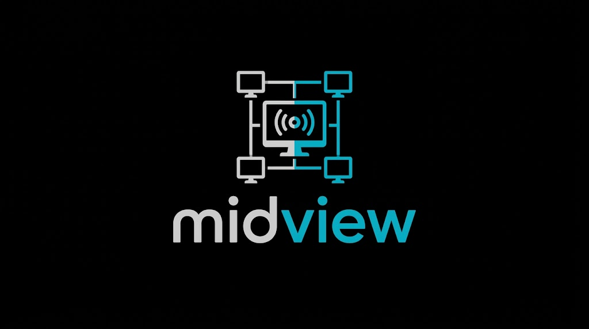
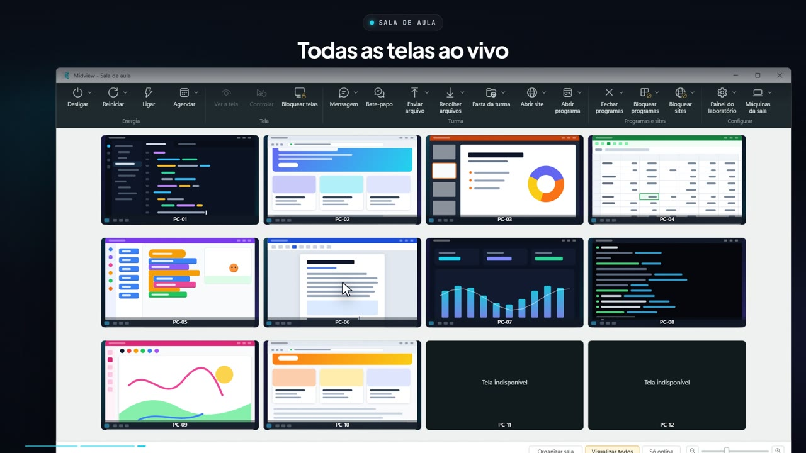

<p align="center">
  
</p>

# Midview

[](https://github.com/ArnoNeto1/midview/releases/latest)
[](https://github.com/ArnoNeto1/midview/releases)
[-0e7490?style=for-the-badge)](https://github.com/ArnoNeto1/midview/releases/latest/download/MidviewSetup.exe)

> O botão acima baixa sempre a versão mais nova. O mesmo instalador serve
> para o computador do professor e para as máquinas dos alunos.
> Página para os professores: https://arnoneto1.github.io/midview/

O Midview gerencia o laboratório de informática da escola. Do próprio computador, o professor vê e controla as máquinas dos alunos, fala com a turma, envia e recolhe arquivos, bloqueia programas e sites e liga ou desliga o laboratório. Tudo passa pela rede local da escola, sem internet e sem servidor externo.

## Veja funcionando

[](https://arnoneto1.github.io/midview/midview.mp4)

[Assista ao resumo com narração](https://arnoneto1.github.io/midview/midview.mp4) (MP4, 3 min): pareamento, a sala ao vivo, desligar com aviso, controlar e bloquear telas, recado, enviar e recolher arquivos, pasta da turma, abrir site, bloquear programas e sites e o painel do laboratório. As máquinas e telas que aparecem nele são fictícias.

### Tutorial completo

Passo a passo, com narração, de todas as funções: instalação, pareamento, a sala de aula, energia, tela, turma, programas e sites, configurações, o botão direito e a sala com dois professores.

[](https://arnoneto1.github.io/midview/tutorial.mp4)

[Assistir ao tutorial](https://arnoneto1.github.io/midview/tutorial.mp4) (MP4, 8 min).

## O que o professor pode fazer

A janela "Midview - Sala de aula" mostra a tela de cada máquina numa grade. Os botões da barra de ferramentas agem na turma toda; o botão direito sobre uma máquina age só nas selecionadas.

| Grupo | Funções |
| --- | --- |
| **Energia** | **Desligar** e **Reiniciar**, com aviso de 1 ou 5 minutos e, se quiser, instalando as atualizações do Windows que estiverem esperando; **Ligar** pela rede (Wake-on-LAN); **Agendar** os dias e horários para ligar e desligar. |
| **Tela** | **Ver a tela** de um aluno; **Controlar** a máquina (o teclado e o mouse do aluno ficam travados e ele vê o aviso "Este computador está sendo controlado pelo professor"). O controle continua mesmo quando aparece a tela do UAC (o pedido de senha de administrador): com a senha do laboratório guardada, **Preencher a senha de administrador** digita no UAC com um clique. **Bloquear telas** com um cadeado. |
| **Turma** | **Mensagem** na tela de todos; **Bate-papo** com a turma (as respostas chegam só ao professor); **Enviar arquivo** para a pasta "Arquivos do professor"; **Recolher arquivos** da pasta "Entregar ao professor"; **Pasta da turma**, uma pasta na Área de Trabalho dos alunos em que o que cada um baixa ou salva aparece em todos os computadores (com turmas, aulas e até dois PCs de professor). |
| **Programas e sites** | **Abrir site** e **Abrir programa** nas máquinas; **Instalar programa** na turma toda, como administrador, sem a tela do UAC e sem digitar senha; **Desinstalar programa**; **Fechar programas**, com aviso e prazo para o aluno salvar; **Bloquear programas** (lista proibida ou só os permitidos); **Bloquear sites** (a internet inteira ou só alguns sites, valendo mesmo depois de reiniciar). |
| **Configurar** | **Painel do laboratório** (políticas do Chrome e do Windows, como bloqueador de anúncios, bloquear downloads e modo visitante); **Máquinas da sala** (procurar na rede, parear conferindo o código em até 5 minutos, entrar na sala de um colega, atualizar pela rede, dar acesso a outro professor e guardar a senha de administrador do laboratório). |

No botão direito há também **Conversar** com um aluno só, **Desinstalar programa**, **Editar a máquina** e **Remover da lista da sala**. Na barra de baixo, **Visualizar todos** encaixa todas as telas, **Só online** esconde as máquinas desligadas e o controle deslizante muda o tamanho das telas (também com Ctrl + roda do mouse). **Organizar sala** deixa arrastar as telas até ficarem como as máquinas estão na sala, e **Alinhar** acerta a grade.

## Como funciona

O mesmo instalador tem dois tipos:

- **Professor**: instala o programa "Midview - Sala de aula", que roda sem direitos de administrador.
- **Aluno**: instala o serviço **Midview Agent**, que roda como sistema em cada máquina do laboratório, e o programa que mostra as mensagens, o bloqueio de tela e os avisos para o aluno.

O professor acha as máquinas pela rede e pareia cada uma conferindo, em até 5 minutos, um código de 6 dígitos que aparece na tela do aluno. Depois disso, a máquina só aceita os professores pareados. Os comandos, as telas e os arquivos passam criptografados com TLS e certificados próprios; só a busca de máquinas e o Wake-on-LAN usam pacotes UDP sem criptografia. O Midview não tem telemetria e não acessa a internet.

Portas usadas na rede local:

| Porta | Uso |
| --- | --- |
| TCP 28900 | Comandos para o serviço do aluno |
| TCP 5901 | Tela e controle remoto |
| TCP 5902 | Tela e controle remoto na tela segura (UAC) |
| UDP 28901 | Busca de máquinas na rede |
| TCP e UDP 28902 | Acesso de outro professor (convite) |
| TCP 28903 | Pasta da turma entre dois PCs de professor |
| UDP 9 | Ligar as máquinas pela rede |

## Requisitos

- Windows 10 ou 11 de 64 bits, no computador do professor e nas máquinas.
- Direitos de administrador para instalar.
- Professor e máquinas na mesma rede local. Para **Ligar**, o Wake-on-LAN precisa estar ativo na BIOS e na placa de rede das máquinas.
- Não é preciso instalar o .NET: ele vem dentro do Midview.

## Instalação

1. Clique em **⬇ Baixar Instalador (.exe)**, lá em cima. Não precisa instalar o .NET nem mais nada.
2. No computador do professor, abra o instalador e escolha **Professor** (se aparecer a tela "O Windows protegeu o computador", clique em **Mais informações** e depois em **Executar assim mesmo**). Ele cria o atalho "Midview - Sala de aula" na Área de Trabalho.
3. Em cada máquina do laboratório, abra o instalador e escolha **Aluno**.
4. No Midview, clique em **Máquinas da sala** > **Procurar na rede**, selecione as máquinas e clique em **Parear as selecionadas**. Confira o código de 6 dígitos que aparece na tela de cada aluno (você tem 5 minutos para isso).

Pareie as máquinas logo depois de instalar: até o primeiro pareamento, qualquer professor da rede pode pareá-las.

O instalador mostra a licença de uso e pede que ela seja aceita. Para instalar muitas máquinas de uma vez, use a instalação silenciosa, que dispensa as telas do instalador:

```powershell
MidviewSetup.exe /VERYSILENT /SUPPRESSMSGBOXES /TIPO=aluno
```

Use `/TIPO=professor` no computador do professor. Sem `/TIPO`, a instalação silenciosa não instala nada. O código de saída 10 indica que os arquivos foram copiados, mas o serviço não pôde ser configurado.

## Atualização

- **Computador do professor**: rode o instalador da versão nova.
- **Máquinas do laboratório**: em **Máquinas da sala** > **Atualizar as máquinas pela rede...**. Uma máquina é atualizada primeiro e as outras só depois que ela confirma; se algo falhar, a máquina volta sozinha para a versão anterior. Cada máquina fica fora da grade por 1 a 3 minutos.

## Mais de um professor

- **Dar acesso a um colega...** mostra um código de 9 caracteres, válido por 10 minutos. O colega digita o código em **Entrar na sala de um colega...** e passa a ver as mesmas máquinas.
- **Permitir novo professor (10 minutos)** deixa as máquinas aceitarem o pareamento de outro professor por 10 minutos.

## Desinstalação

Em **Configurações** > **Aplicativos**, desinstale "Midview Professor" ou "Midview Aluno". Na máquina do aluno, o desinstalador libera o que estava bloqueado e pergunta se deve apagar também os professores pareados.

As políticas do **Painel do laboratório** continuam aplicadas depois da desinstalação. Para tirá-las, use **RESET geral** no painel antes de desinstalar.

## Privacidade

O Midview não envia nada ao desenvolvedor nem à internet. Entre o professor e as máquinas passam as imagens de tela, o texto copiado durante o controle, as mensagens, o bate-papo, os arquivos enviados e recolhidos, os nomes e os endereços MAC das máquinas e os nomes dos programas abertos ou instalados.

A tela do aluno pode ser vista sem aviso na máquina dele; só o controle remoto mostra um aviso. Por isso, a escola deve informar alunos e responsáveis sobre o uso do Midview, como pede a cláusula 6 da [licença](LICENSE).

A senha de administrador do laboratório, se guardada em **Máquinas da sala**, fica só no computador do professor, protegida pelo Windows (DPAPI do usuário), e nunca é enviada às máquinas dos alunos. O **Preencher a senha de administrador** a digita no pedido de UAC da máquina controlada apenas quando o professor clica.

Algumas opções do **Painel do laboratório** configuram o Google Chrome, que pode então acessar serviços do Google por conta própria, por exemplo para baixar o bloqueador de anúncios.

## Para desenvolvedores

| Pasta | Conteúdo |
| --- | --- |
| `src/Midview.Master` | Programa do professor (WPF) |
| `src/Midview.Agent` | Serviço do Windows nas máquinas dos alunos |
| `src/Midview.Session` | Programa que roda na sessão do aluno: tela, controle, mensagens e bloqueio |
| `src/Midview.Desk` | Auxiliar que mostra e controla a tela segura (UAC) e preenche a senha de administrador |
| `src/Midview.Protocol` | Biblioteca comum: mensagens, TLS, pareamento, busca e atualização |
| `tests/` | Testes com xUnit e o teste de ponta a ponta (`Midview.E2E`) |
| `installer/` | Instalador (Inno Setup), scripts das máquinas e seus testes |
| `docs/superpowers/` | Especificações e planos de cada função |
| `site/` | Página para os professores, publicada no GitHub Pages pelo fluxo **Site** |
| `promo/` | Vídeos de divulgação e o tutorial, feitos com Remotion (o GIF e os MP4 de `docs/` saem dele) |

Requisitos: Windows, SDK do .NET 8 e, para o instalador, Inno Setup 6.

```powershell
dotnet build Midview.sln --configuration Release
dotnet test Midview.sln --configuration Release --no-build
```

Alguns testes do serviço precisam de administrador e são pulados sem ele.

Para gerar o instalador em `dist\MidviewSetup.exe` e conferi-lo:

```powershell
powershell -ExecutionPolicy Bypass -File installer\Gerar-Instalador.ps1
powershell -ExecutionPolicy Bypass -File installer\tests\Testar-Scripts.ps1 -Pacote dist
```

A versão fica em `Directory.Build.props`. No GitHub, quatro fluxos conferem cada mudança: **Testes (Windows)**, **Instalador**, **Atualização pela rede (Windows de verdade)** e **Bloqueio de programas (Windows de verdade)**.

## Licença

Copyright © 2026 MidView. Todos os direitos reservados.

O Midview é software proprietário, de uso gratuito para escolas, nos termos da [Licença de Uso](LICENSE). Os componentes de terceiros incluídos e suas licenças estão em [THIRD-PARTY-NOTICES.txt](THIRD-PARTY-NOTICES.txt).
